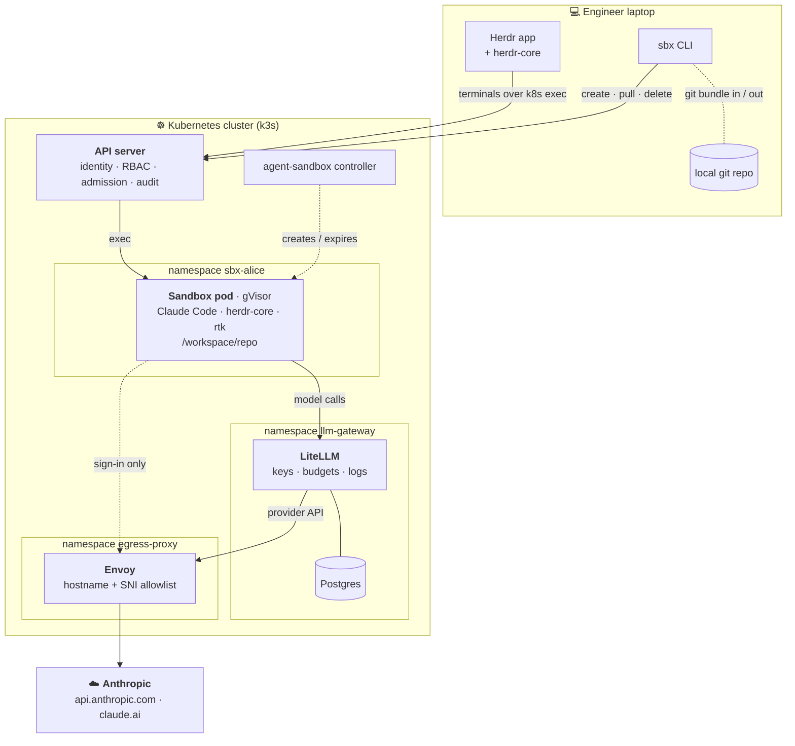

# Remote Coding Agent Platform: prototype

Disposable, isolated sandboxes on Kubernetes where engineers run **Claude Code**
remotely: several in parallel, still running when the laptop sleeps, controlled
from the **Herdr desktop and mobile apps**. The agent is treated as **compromised by
default**: the platform limits what it can **reach**, **spend** and **take out**.

> **Status:** a working single-node slice on k3s. Create a sandbox → the agent
> works on your code → steer it remotely → pull its work back → destroy the
> sandbox. Every control marked **✅ demo** below is enforced on the cluster
> and covered by a test suite.

## Contents

1. [Exercise](#1-exercise)
2. [Architecture at a glance](#2-architecture-at-a-glance)
3. [Developer quick start](#3-developer-quick-start)
4. [Components](#4-components)
5. [Security](#5-security)
6. [Production path and demo limitations](#6-production-path-and-demo-limitations)

---

## 1. Exercise

<details>
<summary><b>📄 Exercise brief</b> (original text, unchanged)</summary>

Exercise:

# **Remote Coding Agent Platform**

Engineers use coding agents locally, but need remote sessions for parallel work and long-running tasks. Design and prototype an internal platform for those sessions. It should be useful to engineers without giving autonomous agents unrestricted access to company systems.

Background: Why Ramp built Inspect. Use it as a reference but don't just copy.

### Parameters

1. Use any open-source tools and AI coding agents you find useful. Explain what you built versus reused.
2. Use AI in your research and implementation but be ready to explain the decisions you made yourself.
3. Design it in whatever cloud platform you are more comfortable with.
4. A local or single-machine prototype is fine.

We will provide a Claude Max subscription for this task. Our recruiter will send access instructions.

### What we’re looking for

Build and demonstrate one end-to-end slice: create and destroy an isolated, disposable development environment, run a coding agent in it, and let an engineer control that session remotely. A local or single-machine prototype is enough but the design should be cover a real setup. For the broader capabilities below, explain the architecture, access boundaries and trade-offs. You do not need to implement every feature.

- **Remote runtime:** create and destroy isolated, secure, disposable development environments.
- **Agent support:** Lets limit ourselves to Claude Code and Codex. Think about permission modes and safe handling of remote authentication. Consider implications of subscription-based use here instead of only API pricing.
- **Remote control:** let an engineer start and monitor multiple sessions, send follow-up prompts, attach and stop them without staying on the original machine.
- **IaC:** use of and best practices around IaC.
- **Threat model:** cover prompt injection, credential theft and other forms of exfiltration, untrusted dependencies, insecure agent-written code and runaway spend.

### Review

We will discuss the submission in 2 interviews:

- Second interview (SRE/ITOps): review the working slice and its implementation details - IaC, network design, isolation, identity and access, security posture, operational controls and tests. Discuss what the prototype demonstrates and how the design would work in a real environment.
- Final interview (founder): discuss the higher-level platform architecture, engineer experience and key trade-offs. Explore the security model and threat scenarios - including what a compromised or manipulated agent could reach and how the platform limits the impact - without repeating the IaC and network implementation review. Use the prototype to ground the discussion, distinguish demonstrated controls from those still in the design.

Please share your repository link at least one day before the interview.

### Scope

Scope the prototype to a few focused hours. We don't expect every part of the platform to be implemented. Cut features before you cut reasoning, and make the important design and security decisions yourself. We'd much rather see a small working slice whose architecture, access boundaries and trade-offs you understand deeply than a broad prototype you can't defend. Be clear about what you built, what you would add next, and what remains only in the design.

</details>

---

## 2. Architecture at a glance



- **One sandbox = one pod** from a platform-owned template. It runs under **gVisor**
  (user-space kernel), in the engineer's **own namespace**, and expires after a TTL.
- **Remote control goes through the Kubernetes exec API only.** No SSH, no open
  port, no extra credential. Every connection is authenticated, checked against
  RBAC *and* an owner admission policy, and audited.
- **The Herdr app** shows each sandbox as a machine: terminals, agents, follow-up
  prompts. Sessions keep running in the sandbox when the laptop disconnects.
- **Model traffic goes through LiteLLM**, which authenticates each developer,
  enforces budgets and rate limits, and attributes spend per developer and sandbox.
- **The only internet route is Envoy**, which allows a handful of Anthropic
  hostnames, checked by CONNECT target *and* TLS SNI. GitHub, npm and everything
  else are blocked.
- **Code moves through `sbx`:** in as a git bundle at create, out into a local
  branch at delete. The sandbox holds no git credentials.

---

## 3. Developer quick start

<details>
<summary><b>💻 One-time laptop setup</b> (Herdr app, sbx, cluster access)</summary>

| Tool | Install | What for |
|---|---|---|
| **Herdr desktop app** | `curl -fsSL https://releases.herdr.dev/app/install.sh \| sh`, then open **Herdr**.<br/>macOS: `brew install --cask herdr-app` | See and drive your sandboxes |
| **herdr-core** (`hc`) | installed by the app installer | The app's engine; `sbx` registers sandboxes in it |
| **sbx** | `cd cli && go build -o bin/sbx ./cmd/sbx`, then put `bin/sbx` on your `PATH` | Create, list, pull and delete sandboxes |
| **Cluster access** | a kubeconfig (demo). Production: company SSO via `sbx` | Your identity for everything |

Then check that you are onboarded (a platform admin ran `developer.sh add <you>`):

```shell
sbx whoami        # user: alice@corp.com   namespace: sbx-alice
```

> **Demo cluster:** the kubeconfig is the cluster admin, so act as a developer
> with `sbx --as alice@corp.com …` (impersonation, see [limitations](#demo-limitations)).

</details>

<details>
<summary><b>🛠️ Platform install</b> (admins, in order)</summary>

```shell
# 0. k3s, a local registry (localhost:5000), the devbox image      → k8s/README.md, image/
# 1. agent-sandbox v1.0.10 (upstream manifests)                     → k8s/README.md
sudo k8s/runtimes/gvisor/install.sh && kubectl apply -f k8s/runtimes/gvisor/runtimeclass.yaml
k8s/runtimes/kata/install.sh                                        # optional, needs /dev/kvm
kubectl apply -f k8s/policies/00-namespaces.yaml && kubectl apply -f k8s/policies/
kubectl apply -k k8s/egress-proxy
k8s/llm-gateway/install.sh                                          # LiteLLM + Postgres, secrets generated
kubectl apply -f k8s/developers/cluster/
k8s/developers/developer.sh add alice@corp.com                      # namespace + gateway key
```

</details>

**1. Create a sandbox from your repo.** The committed history is copied in, on
branch `agent/fix-login`. It appears as `sbx-fix-login` in the Herdr app.

```shell
cd ~/src/my-app
sbx create fix-login                 # ready in a few seconds; deleted automatically after 8 h
```

**2. Start Claude Code.** In the Herdr app, open a space on `sbx-fix-login` and start
Claude Code in `/workspace/repo`. The first time, run `/login` and finish sign-in in
your own browser. From a terminal instead:

```shell
hc run --on sbx-fix-login --bg claude "Fix the login redirect bug"
```

**3. Steer it.** Run several sandboxes in parallel, type follow-up prompts, attach and
detach. Close the laptop: agents keep running. From another computer: `sbx connect fix-login`.

**4. Get the work back and finish.**

```shell
sbx pull fix-login                   # optional, any time: → local branch sbx/fix-login
sbx delete fix-login                 # pulls one last time, then destroys the sandbox
git log -p HEAD..sbx/fix-login       # review
git merge sbx/fix-login              # then push to GitHub yourself
```

Pulls work like `git fetch`: your working tree and current branch are never touched.

<details>
<summary><b>More commands</b></summary>

```shell
sbx list                             # your sandboxes, status, expiry
sbx shell fix-login                  # interactive bash in the sandbox
sbx exec fix-login -- git status     # one command, exit code preserved
sbx push fix-login                   # copy the repo in later (if create ran elsewhere)
sbx prune                            # forget Herdr entries of expired sandboxes
```

Full guide and troubleshooting: [docs/developer-guide.md](docs/developer-guide.md).

</details>

---

## 4. Components

| Component | What it does | Key choices | Details |
|---|---|---|---|
| **Cluster + agent-sandbox** | k3s single node; `SandboxTemplate` / `SandboxClaim` lifecycle, TTL expiry | Upstream controller v1.0.10, no fork | [k8s/](k8s/README.md) |
| **Runtimes** | gVisor (default) and Kata Containers (microVM) | gVisor for ~0.6 s starts and density; Kata kept for a hardware boundary | [k8s/runtimes/](k8s/runtimes/README.md) |
| **Session policies** | Pod Security `restricted`, admission policies, quotas, default-deny network, the session template | Admission on templates *and* pods; only gVisor/Kata and the platform registry | [k8s/policies/](k8s/policies/README.md) |
| **Claude Code managed settings** | Permission modes, deny rules, model endpoint, rtk hook | Autonomous inside the sandbox; a cloned repo cannot loosen anything | [k8s/policies/ § Permission modes](k8s/policies/README.md#permission-modes-claude-code) |
| **Developer namespaces** | One namespace per engineer, RBAC + owner admission, quota, gateway key | Two independent checks; a wrong RoleBinding still does not open a colleague's sandbox | [k8s/developers/](k8s/developers/README.md) |
| **Egress proxy** | The only internet route: hostname allowlist, then SNI check | Upstream Envoy, declarative, no custom code | [k8s/egress-proxy/](k8s/egress-proxy/README.md) |
| **LLM gateway** | LiteLLM + Postgres: virtual keys, budgets, rate limits, spend logs | Subscription mode for the exercise; API-key mode recommended | [k8s/llm-gateway/](k8s/llm-gateway/README.md) |
| **devbox image** | What every sandbox runs: Claude Code, herdr-core, rtk, git | Every input pinned by digest or checksum; no SSH | [image/devbox/](image/devbox/README.md) |
| **rtk** (token savings) | Cuts the tokens the agent spends reading command output. A Claude Code hook rewrites each shell command (`git status` → `rtk git status`), and the model receives a condensed result (failing tests, changed files, lint errors) instead of the full output. Lowers cost and helps long sessions stay within context and plan limits | Open-source `rtk-oss` edition, pinned by checksum; the hook lives in managed settings so a repo cannot remove it; project filter files ignored (a repo could hide failing tests); deny rules written to match the rewritten commands | [image/devbox/ § rtk](image/devbox/README.md#rtk-token-savings) |
| **sbx CLI** | Create, list, exec, pull, delete; Herdr transport | Go, client-go, exec API only | [cli/](cli/README.md) |

### Built vs reused

| Reused (upstream, pinned) | Written for this prototype |
|---|---|
| k3s, **agent-sandbox** controller and CRDs, gVisor, Kata (kata-deploy chart) | Session template, admission policies (one adapted from agent-sandbox's examples), NetworkPolicies, quotas |
| **Envoy**, **LiteLLM**, Postgres | Envoy config (two listeners, CONNECT + SNI), LiteLLM config, key scripts |
| **Claude Code**, **Herdr app / herdr-core**, **rtk** | Managed settings and permission policy, devbox image |
| client-go, cobra | `sbx` CLI (~1,400 lines of Go), developer tenancy (RBAC, owner policies, `developer.sh`) |
| | Test suites and documentation |

### Tests

Every suite runs against the live cluster.

| Suite | Checks | Covers |
|---|---|---|
| [`k8s/runtimes/test/verify.sh`](k8s/runtimes/test/verify.sh) | 3 runtimes | runc / gVisor / Kata kernels |
| [`k8s/policies/test/verify.sh`](k8s/policies/test/verify.sh) | 20 | insecure specs rejected; network reachability from a session |
| [`k8s/llm-gateway/test/verify.sh`](k8s/llm-gateway/test/verify.sh) | from a session | keys, budgets, rate limits, egress allowlist and SNI |
| [`k8s/developers/test/verify.sh`](k8s/developers/test/verify.sh) | 26 | isolation between developers; gateway key |
| [`k8s/developers/test/permissions.sh`](k8s/developers/test/permissions.sh) | 14 | Claude Code permission policy (real headless runs) |
| [`cli/test/code.sh`](cli/test/code.sh) | 17 | code in and out, untouched local work, no hooks copied |

---

## 5. Security

Full analysis: **[docs/threat-model.md](docs/threat-model.md)**.
**✅ demo** = enforced and tested · **📐 design** = described, not built.

### What a compromised agent can reach

| From inside a sandbox | Result |
|---|---|
| Host kernel | gVisor user-space kernel in between (Kata VM available) ✅ |
| Kubernetes API, node, metadata, other pods | **blocked**, no service account token ✅ |
| A colleague's sandbox | **blocked** by RBAC *and* admission ✅ |
| LiteLLM | allowed, with a budgeted key that only works inside the cluster ✅ |
| GitHub, npm, any other host | **blocked** (Envoy allowlist + SNI) ✅ |
| `api.anthropic.com` directly | allowed in subscription mode (sign-in needs it), blocked in API-key mode ⚠️ |
| DNS | resolves external names: low-bandwidth exfiltration channel, accepted ⚠️ |

### Threats and controls

| Threat | Main controls | Status |
|---|---|---|
| **Prompt injection** | Assume it succeeds: nothing worth stealing, nowhere to send it. Managed settings a repo cannot change; web tools and cloud-agent tool (`RemoteTrigger`) removed | ✅ demo |
| **Credential theft** | No SA token, no git or provider credential in the sandbox. Gateway key unusable outside the cluster. Subscription OAuth token *is* present after `/login` (removed by API-key mode) | ✅ demo / ⚠️ subscription |
| **Exfiltration** | Default-deny network, Envoy allowlist + SNI, code leaves only via `sbx pull` into a branch the engineer reviews | ✅ demo; DNS gap ⚠️ |
| **Untrusted dependencies** | No route to public registries; pinned, checksummed image inputs; platform registry only | ✅ demo; internal mirror 📐 |
| **Insecure agent code** | Sandbox contains execution; nothing runs on the laptop (hooks never copied); human review before merge | ✅ demo; CI scanning, branch rules 📐 |
| **Runaway spend** | Per-developer key: $50/day, 120 req/min; global $200/day; quota 2 sandboxes; 8 h TTL | ✅ demo; idle reaper 📐 |
| **Access to internal tools** | No route exists; future tools only as MCP servers behind the gateway | ✅ demo / 📐 |

### Subscription vs API key

The exercise provides a **Claude Max subscription**, so each engineer signs in
with `/login` inside their own sandbox. The platform never stores that token
(Anthropic's terms forbid platforms collecting or intermediating Claude.ai
credentials). The trade-offs: the token lives in the sandbox, the gateway is the
default path rather than a hard boundary, and dollar budgets are an API-price
meter, not real cost. **For production: API keys held only by the gateway.**
Details: [k8s/llm-gateway/ § Subscription vs API key](k8s/llm-gateway/README.md#subscription-vs-api-key-what-we-chose-and-why).

---

## 6. Production path and demo limitations

### Infrastructure as code

**Today:** every Kubernetes object is declarative YAML or kustomize, with versions
pinned by digest or checksum. Developer onboarding is a committed overlay
(`k8s/developers/users/<slug>/`). A few steps are still imperative scripts:
node runtime install, secret generation, gateway keys.

**Production:**

| Layer | Tool | What changes |
|---|---|---|
| Cloud infra | **Terraform / OpenTofu** | VPC, managed Kubernetes (e.g. GKE with GKE Sandbox for gVisor), a **dedicated, tainted node pool** for sandboxes, a KVM pool for Kata, managed Postgres, IAM, secret manager |
| Cluster config | **GitOps** (Argo CD or Flux) | The `k8s/` directories as applications with dev / staging / prod overlays; no `kubectl apply` by hand |
| Secrets | **External Secrets** | Master key, DB password, provider keys from the secret manager instead of `install.sh` |
| Onboarding | IdP group sync → generated PR | `users/<slug>/` rendered from the IdP; keys issued and rotated by a pipeline |
| Policy as code | CI on every PR | Schema validation, admission-policy tests on an ephemeral cluster (the `verify.sh` suites), diff of copied templates |
| Supply chain | CI image builds | **Renovate** with a minimum release age, SBOM, **cosign** signatures verified at admission |

### Demo limitations

- **No real cluster authentication.** `sbx` uses the admin kubeconfig and
  impersonates `alice@corp.com` / `bob@corp.com`. OIDC login is a placeholder;
  RBAC and admission are real.
- **Claude Code only.** Codex is not implemented (design: API-key mode through LiteLLM).
- **Subscription mode** (see [Security](#subscription-vs-api-key)).
- **Single node, single LiteLLM replica, local insecure registry**, no HA, no backups.
- **Code transfer through the laptop.** Production: an in-cluster git gateway
  forwarding only allowlisted repos and holding a short-lived GitHub App token
  ([cli/ § Code in and out](cli/README.md#code-in-and-out-demo-push--pull-over-exec)).
- **No persistent workspace**: a sandbox that expires loses unpulled work.
- **Per-developer gateway key**, long-lived, not per sandbox.
- **Open gaps**: DNS exfiltration, image signatures not enforced, no idle reaper.

### Other sandbox options considered

The platform's value is in the policies around the sandbox (identity, egress,
gateway, permissions), so the runtime is swappable:

| Option | Fit |
|---|---|
| **agent-sandbox on Kubernetes** (chosen) | Self-hosted, Kubernetes-native identity and policy, gVisor or Kata, scales to a team |
| **nono** (local) | Kernel-enforced sandbox for agents on the engineer's own machine; good for local runs, not for remote sessions |
| **Docker Sandboxes** | MicroVM per agent on a workstation; simple, but local and per-machine. Remote SaaS option is possible if budget allows |
| **Cloudflare Sandboxes**, E2B, Modal, Daytona | Other managed remote sandboxes with an API and different levels of isolation |